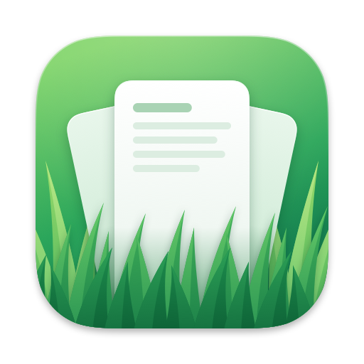
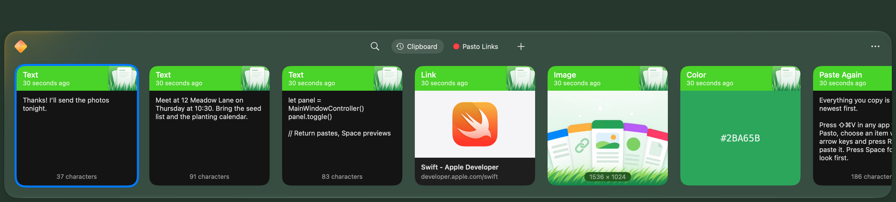
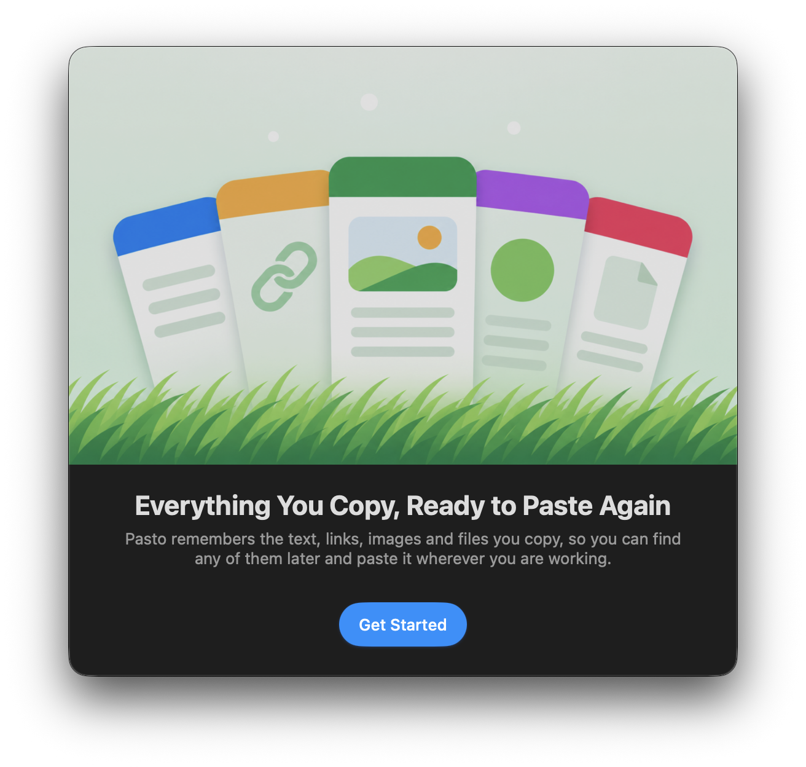
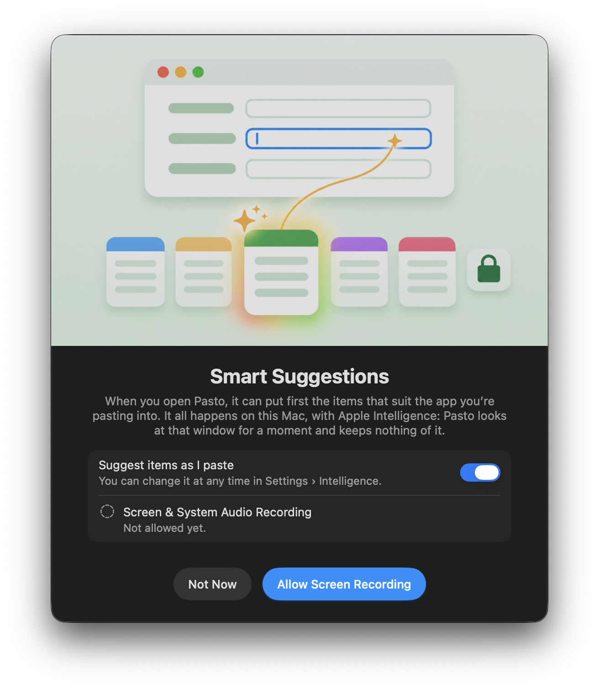
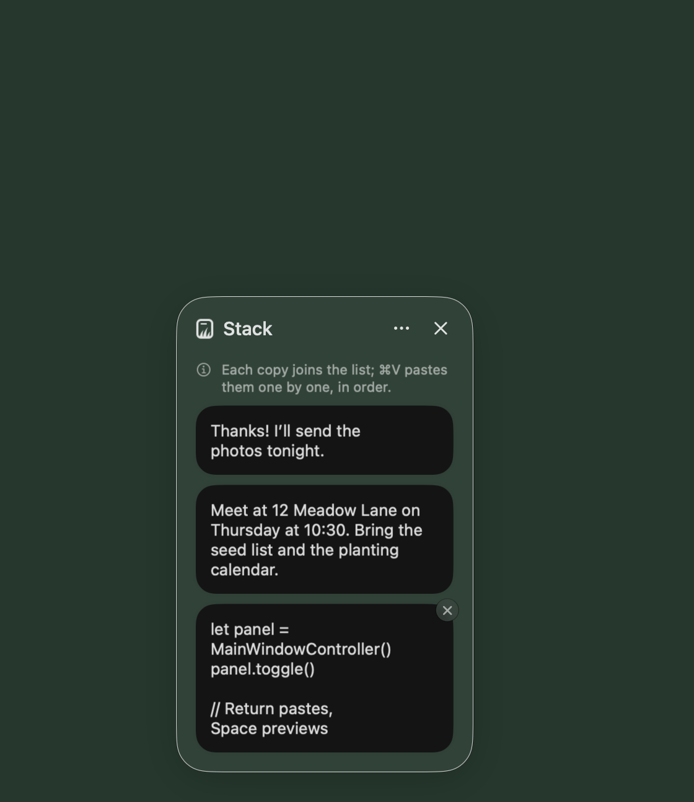
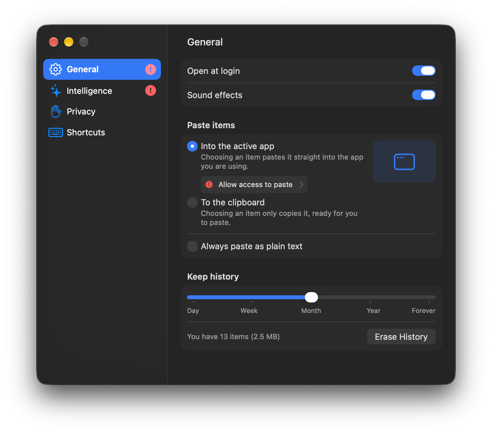
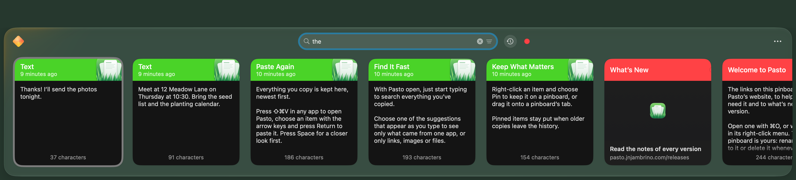
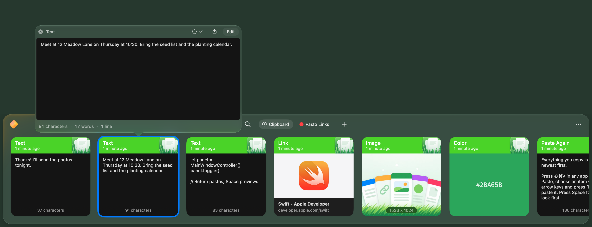
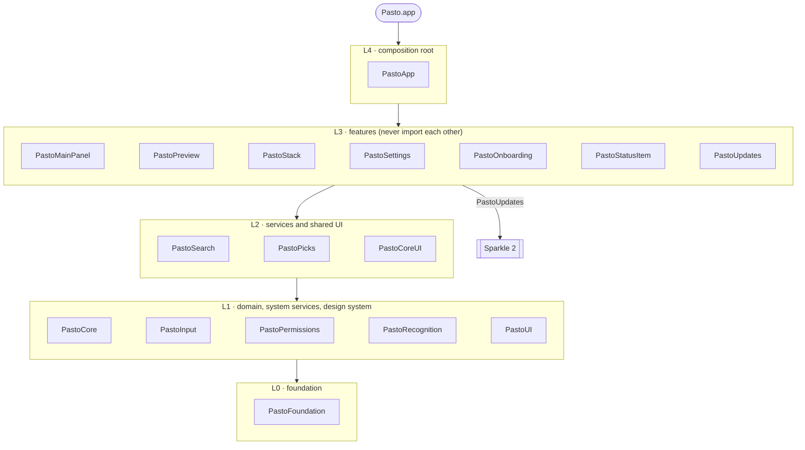

<p align="center">
  
</p>

<h1 align="center">Pasto</h1>

<p align="center">A free clipboard manager for the Mac. Everything you copy, one shortcut away.</p>

<p align="center">
  <a href="https://github.com/jnjambrin0/Pasto/releases/latest"></a>
  <a href="LICENSE"></a>
  
  
</p>

<p align="center">
  
</p>

Pasto keeps a history of everything you copy (text, links, images, files and colours) in a panel that slides up
from the bottom of the screen. Press ⇧⌘V, pick a card, and it is pasted where you were. Everything stays on your Mac.

| Welcome | Suggestions | Stack | Settings |
|:---:|:---:|:---:|:---:|
|  |  |  |  |

## Download

**[Download Pasto from pasto.jnjambrino.com](https://pasto.jnjambrino.com)**, or get the disk image from
[GitHub Releases](https://github.com/jnjambrin0/Pasto/releases). Open it, drag Pasto to Applications, and the
welcome window walks you through the permissions. Pasto is signed with a Developer ID, notarised by Apple, and
updates itself.

**Requirements**

- A Mac with Apple silicon, running **macOS 27** or later.
- Suggestions need Apple Intelligence to be available and turned on.

## Features

- **History.** Everything you copy: plain and rich text, links with their title and image, images, files and
  colours, each with the app it came from. Keep it for a day, a week, a month, a year or forever. Copying something
  again moves it to the front instead of duplicating it.
- **Search.** Start typing in the panel. Narrow results by type, app, date, pinboard or device with filters, and
  find the **words inside images and screenshots**, recognised on your Mac.
- **Pinboards.** Keep the clips you reuse in named, coloured lists. Pinned clips never expire.
- **Paste your way.** Return pastes straight into the app you were using; ⇧Return pastes **plain text**; **⌘1–⌘9**
  paste one of the first nine cards directly. Prefer to paste yourself? Switch to *To the clipboard*.
- **Stack.** Press ⇧⌘C to start a Stack, keep copying, then paste the items one after another with ⌘V, in order,
  or all at once.
- **Preview and edit.** Press Space to look at a clip: edit text (with formatting and Writing Tools), rotate
  images, select text in images, browse a link's page, Quick Look files. ⌘N writes a new text item.
- **Privacy controls.** Pause capture for 15 minutes to 8 hours or until you resume. Password managers are ignored
  out of the box, as is content apps mark as confidential or transient. Ignore any app you like, and hide Pasto's
  windows from screen sharing.
- **Smart suggestions.** With Apple Intelligence, Pasto looks at the window you are about to paste into, works out
  what kind of field it is (an address, a search box, code…) with the **on-device** model, and puts the clips that
  fit first. The image is never stored and nothing leaves your Mac.
- **English and Spanish**, throughout the app.
- **Automatic updates** with [Sparkle](https://sparkle-project.org): a daily check, signed updates, release notes
  in the update window.
- **Accessibility.** VoiceOver labels and actions on every card, full keyboard navigation, and support for Reduce
  Motion and Increase Contrast.

<p align="center">
  
  <br><em>Type to search; suggestions and the filter browser narrow the results by app, type, date, device or pinboard.</em>
</p>

<p align="center">
  
  <br><em>Space previews the selected card; Edit changes it before you paste.</em>
</p>

## Keyboard shortcuts

| Shortcut | Action |
|---|---|
| ⇧⌘V | Open or close the panel (changeable in *Settings › Shortcuts*) |
| ⇧⌘C | Start a Stack with the current selection (changeable) |
| Return, double-click | Paste the selected card |
| ⇧Return | Paste as plain text |
| ⌘1 … ⌘9 | Paste one of the first nine cards (add ⇧ for plain text; the modifier is changeable) |
| Space | Preview the selected card |
| ⌘E | Edit the selected card |
| ⌘C | Copy the selected cards and close the panel |
| ⌘N / ⇧⌘N | New text item / new pinboard |
| Just type, or ⌘F | Search (⌘F again opens the filters) |
| ← → , Home, End | Move between cards (add ⇧ to extend the selection) |
| ⌘← / ⌘→ | Previous / next pinboard |
| ⌘R / ⌘O | Rename / open the selected card |
| Delete, ⌘Z | Delete the selected cards, undo |
| ⌃Return | Context menu for the selected card |
| Esc | Leave search, close the preview, close the panel |
| ⌘, | Settings |

While a Stack is open, ⌘V pastes its next item and ⌃⌥⌘V pastes them all.

## Privacy

Pasto keeps your history on your Mac and has no account, no server, no analytics and no telemetry. It only goes
online to fetch link previews (which you can turn off), to load a link's page when you preview it, and to check for
updates. Suggestions look at the destination window on-device and never keep the image. Details:
[docs/PRIVACY.md](docs/PRIVACY.md).

## Architecture at a glance

Almost all of Pasto lives in a Swift package, `Packages/PastoKit`, split into seventeen modules in five layers.
Dependencies only point down, and feature modules never import each other. The panel and its cards are AppKit,
with a custom collection view and animator; settings, the welcome, the permission windows and the Stack are
SwiftUI. Data lives in Core Data with a single background writer, and search uses an on-device Core Spotlight index.



The full picture (module by module dependencies, the capture, paste and suggestion flows, the data model and the
concurrency model) is in **[docs/ARCHITECTURE.md](docs/ARCHITECTURE.md)**.

## Build from source

**You need** a Mac with Apple silicon on macOS 27, and Xcode 27.2 or later.

```bash
git clone https://github.com/jnjambrin0/Pasto.git
cd Pasto
scripts/test.sh                      # unit tests of Packages/PastoKit
scripts/build.sh                     # Debug build into build/DerivedData
scripts/run.sh --in-memory-store     # install to ~/Applications and launch, without touching a real history
```

Or open `Pasto.xcodeproj`, choose the **Pasto** scheme and run.

**Code signing.** Debug builds are signed automatically with an *Apple Development* certificate of the
maintainer's team. If you are not on that team, point the build at your own team (a free Apple ID's Personal Team
works) without editing the project:

```bash
echo 'DEVELOPMENT_TEAM = <YOUR_TEAM_ID>' > ~/pasto-local.xcconfig
export XCODE_XCCONFIG_FILE=~/pasto-local.xcconfig
```

In Xcode you can pick your team in the target's *Signing & Capabilities* instead; just do not commit that change.
Avoid ad hoc signing: macOS would forget Pasto's permissions after every rebuild.

Development builds are `jnjambrino.Pasto.dev`, with their own data, settings and permissions, so they never touch an
installed copy of Pasto. Launch arguments, tests, conventions and tools are described in
**[docs/DEVELOPMENT.md](docs/DEVELOPMENT.md)**; releases in [docs/RELEASING.md](docs/RELEASING.md).

## Project layout

```text
Pasto/                The app target: entry point, asset catalog, icon, sounds, Info.plist strings
Packages/PastoKit/    The app's code: 17 modules and their unit tests
Config/               Info.plist keys, release settings, export options, disk image artwork
scripts/              build, run, test, release and illustration import
Tools/                Developer tools: benchmarks, UI probe, card gallery, icon and sound generators
Design/               Icon exports and the source artwork of the illustrations
docs/                 Architecture, development, releasing, privacy, design notes and release notes
```

## Contributing

Bug reports, ideas and pull requests are welcome. Please read **[CONTRIBUTING.md](CONTRIBUTING.md)** first, and
follow the [Code of Conduct](CODE_OF_CONDUCT.md). Security problems go through a private report: see
[SECURITY.md](SECURITY.md).

## License

Pasto is released under the [MIT licence](LICENSE). © 2026 Jaime Navas.

## Acknowledgements

Pasto uses [Sparkle](https://sparkle-project.org) (MIT licence) for updates. The licence texts of the third-party
software inside the app are in
[`Acknowledgements.md`](Packages/PastoKit/Sources/PastoOnboarding/Resources/Acknowledgements.md), also shown in
*Help › Acknowledgements*.
