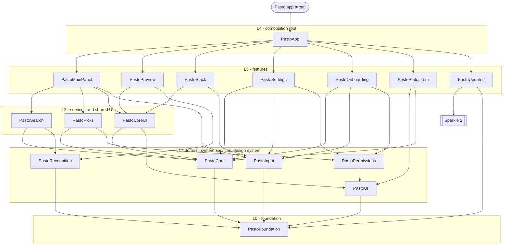
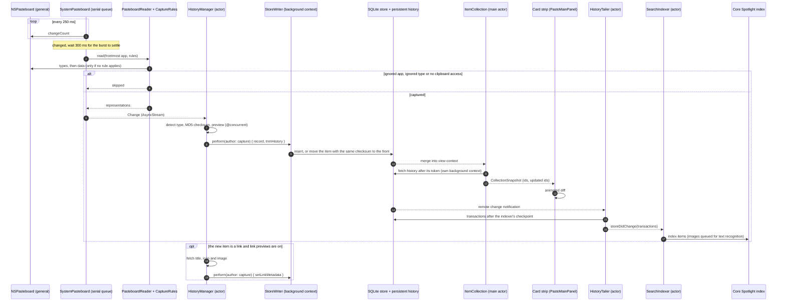
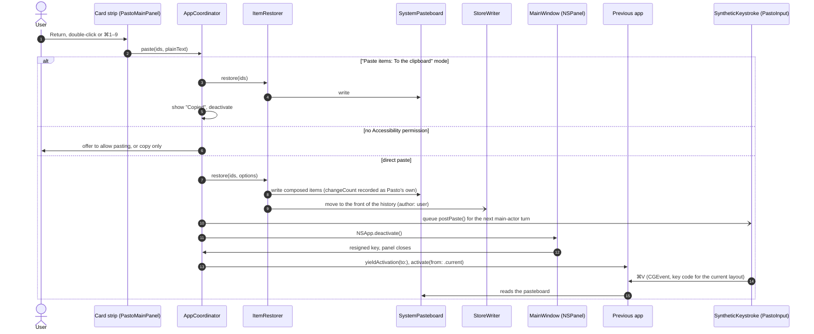
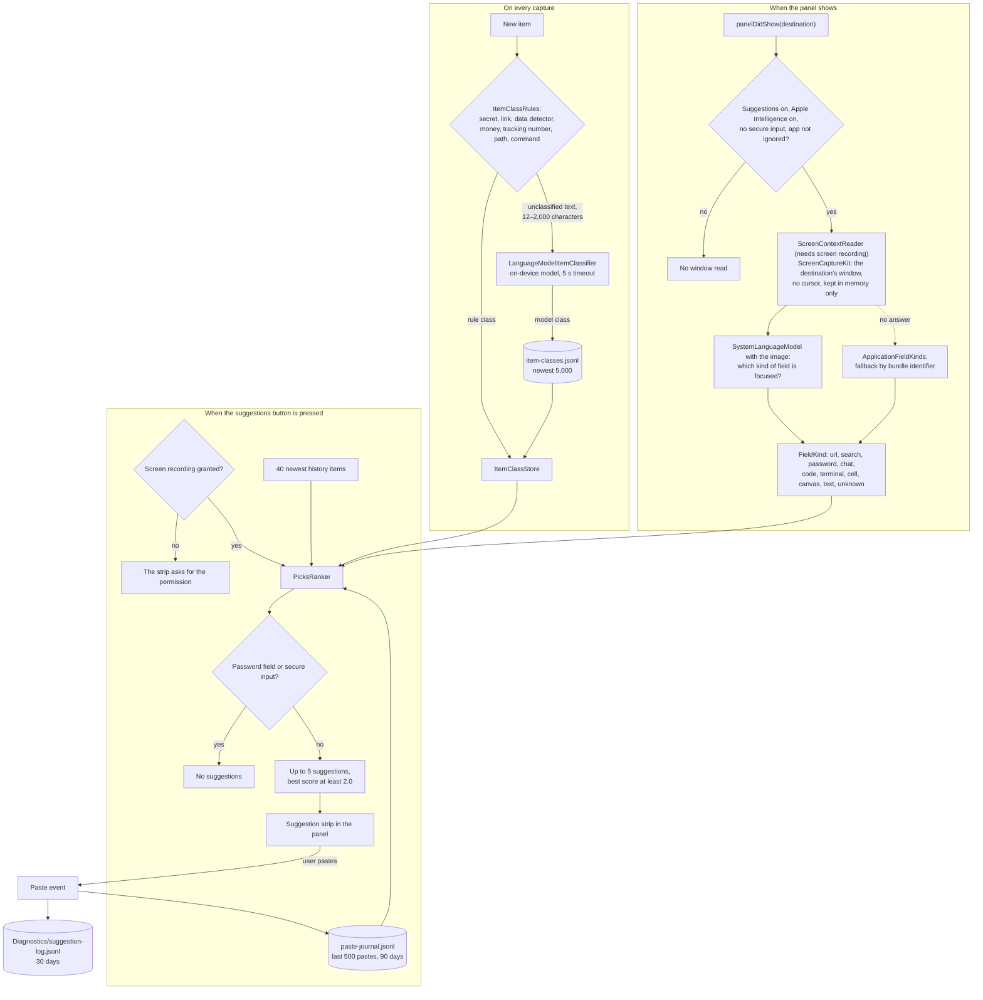
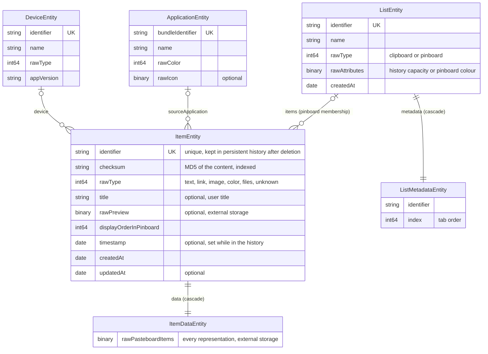
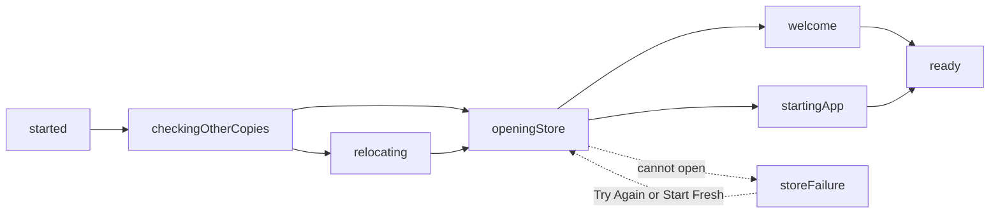

# Architecture

Pasto is a menu bar app for macOS 27 written in Swift 6. Almost all of its code lives in one Swift package,
`Packages/PastoKit`, split into seventeen modules. The Xcode project builds a thin app target, `Pasto`, whose
`main.swift` calls `PastoApplication.main()` from the `PastoApp` module; the target adds the asset catalog, the
icon, the sounds and `Info.plist`.

This document describes how the modules fit together, how the main flows run, and the rules that keep it that
way. For setting up, building and testing, see [DEVELOPMENT.md](DEVELOPMENT.md).

## Contents

- [Module graph](#module-graph)
- [Capture: from a copy to the panel](#capture-from-a-copy-to-the-panel)
- [Paste: from a card to the other app](#paste-from-a-card-to-the-other-app)
- [Suggestions](#suggestions)
- [Data model](#data-model)
- [Persistence](#persistence)
- [Search](#search)
- [Concurrency](#concurrency)
- [User interface](#user-interface)
- [Launch](#launch)
- [Updates](#updates)
- [Diagnostics and logging](#diagnostics-and-logging)
- [Performance notes](#performance-notes)

## Module graph

The source of truth is [`Packages/PastoKit/Package.swift`](../Packages/PastoKit/Package.swift). Modules are
arranged in layers:

- **Dependencies only point down.** The one exception is inside L1: `PastoPermissions` uses the design system's
  button styles from `PastoUI`.
- **Feature modules (L3) never import each other.** The composition root, `PastoApp`, creates them and connects
  them with closures.
- **Only `PastoUpdates` has an external dependency**: [Sparkle](https://sparkle-project.org) 2.

The diagram below is generated from `Package.swift` and shows the transitive reduction of the graph: an edge
that is implied by a longer path is left out (for example, every module also imports `PastoFoundation`
directly, and `PastoApp` imports every module). The table after it lists every direct dependency.

| Layer | Module | Responsibility | Default isolation | Direct dependencies |
|---|---|---|---|---|
| L0 | `PastoFoundation` | Logging, typed settings (`ConfigStore` over `UserDefaults`), `CollectionSnapshot` and diffing, launch phases and records, the single-instance policy, deadlines, owner-only file access, app identity | nonisolated | — |
| L1 | `PastoCore` | Core Data model and stack, the single writer, readers, pasteboard capture and writing (`SystemPasteboard`), capture rules, type detection, link metadata, restoring items to the pasteboard, settings keys, value types (`Item`, `ItemID`, `ClipList`) | nonisolated | Foundation |
| L1 | `PastoInput` | Global hot keys (Carbon), the shortcut model and validation, recording a shortcut, key-code resolution for the current layout, the synthetic ⌘V | nonisolated | Foundation |
| L1 | `PastoPermissions` | Accessibility, clipboard access and screen recording status; the permission windows (SwiftUI) and their illustrations; relaunch after a grant | nonisolated (UI is `@MainActor`) | UI, Foundation |
| L1 | `PastoRecognition` | Text recognition in images (Vision) | nonisolated | Foundation |
| L1 | `PastoUI` | Design system: layer-backed views, the custom `CollectionView`, `Animator`, controls, the on-screen display, notice cards, guide labels. It knows nothing about Core Data | MainActor | Foundation |
| L2 | `PastoSearch` | Query model and parser, the Core Spotlight index and indexer, search sessions, filter suggestions | nonisolated | Core, Recognition, Foundation |
| L2 | `PastoPicks` | Suggestions: item classes (rules and the on-device model), reading the destination window (ScreenCaptureKit), ranking, the paste journal | nonisolated (the provider is `@MainActor`) | Core, Permissions, Foundation |
| L2 | `PastoCoreUI` | Card cells by item type and density, card header, content views, thumbnail decoding | MainActor | Core, UI, Foundation |
| L3 | `PastoMainPanel` | The panel window and controller, the show/hide state machine, toolbar, tabs, search UI, the card strip, suggestions mode, the in-panel guide | MainActor | Search, Picks, CoreUI, UI, Core, Input, Foundation |
| L3 | `PastoPreview` | Preview, text and image editing, Quick Look, new text items | MainActor | CoreUI, UI, Core, Recognition, Foundation |
| L3 | `PastoStack` | The Stack panel and its model | MainActor | CoreUI, UI, Core, Input, Foundation |
| L3 | `PastoSettings` | The settings window and its panes | MainActor | UI, Core, Input, Permissions, Foundation |
| L3 | `PastoOnboarding` | Launch decisions, the welcome flow, welcome content, notice catalogue, About and acknowledgements | MainActor | UI, Core, Input, Permissions, Foundation |
| L3 | `PastoStatusItem` | Menu bar icon and its menu | MainActor | UI, Core, Foundation |
| L3 | `PastoUpdates` | `UpdateController`, a wrapper around Sparkle's standard updater | MainActor | Sparkle, Foundation |
| L4 | `PastoApp` | Composition root: `Services`, `AppCoordinator`, the launch sequence, menus, pause, data removal, problem reports, debug arguments | MainActor | every module |

## Capture: from a copy to the panel

`SystemPasteboard` polls the general pasteboard's `changeCount` on a private serial queue every 250 ms. When it
changes, it waits for the burst to settle (300 ms after the last change) and then reads it. Every access to the
general pasteboard goes through this type.

Reading happens in a fixed order, so that nothing private is read when it does not have to be: the clipboard
access status, then the item types, then the capture rules (ignored apps, the `org.nspasteboard.source` marker,
ignored pasteboard types such as `org.nspasteboard.ConcealedType` and `TransientType`), and only then the data,
with a 1 GiB limit per read.

Details worth knowing:

- **Deduplication.** Items are identified by an MD5 checksum of their content. Copying something that is already
  in the history moves that item to the front (its `timestamp` is updated); copying an item that was only on a
  pinboard adds it back to the history. A burst that ends on the item that is already newest is not announced.
- **Pasto's own writes.** When Pasto writes to the pasteboard, `SystemPasteboard` records the resulting
  `changeCount`, so the next poll does not see a change, and drops any read that was overtaken by its own write.
- **Pause.** Pausing stops the polling timer. On resume, whatever is on the pasteboard counts as already seen.
- **The panel list.** `ItemCollection` does not wait for the indexer: it follows persistent history on its own
  background context and publishes `CollectionSnapshot<ItemID>` values on the main actor, which the custom
  `CollectionView` applies as an animated diff.
- **Link metadata.** Pasto downloads the page itself with an ephemeral `URLSession` (no cookies, cache or
  credentials), reads it only up to `</head>`, and refuses local and private addresses, including after redirects
  and DNS resolution. See [PRIVACY.md](PRIVACY.md).
- **Text in images** is recognised later, by the indexer, not during capture (see [Search](#search)).

## Paste: from a card to the other app

The panel is a non-activating `NSPanel`: it takes key focus for keyboard navigation while the app the user was
working in stays frontmost. A paste is a single synchronous turn on the main actor, with no timers: the items go
on the pasteboard, the keystroke is queued for the next main-actor turn, and Pasto deactivates. Losing key status
closes the panel, which hands activation back to the previous app; by the time the queued ⌘V is posted, that app
is frontmost again.

- **Plain text** (⇧Return, the plain-text modifier with ⌘1–9, or *Always paste as plain text*) writes only a
  plain-text representation (`RestoreOptions.plainText`).
- **Without Accessibility** Pasto cannot post the keystroke. The user is asked to allow it or to copy only, and
  may make copy-only the default (*Settings › General › Paste items*).
- **Large images.** Conversions that would take noticeable time (such as a PNG copy of a large TIFF) are done
  after the pasteboard write, in the background; the pasteboard holds a promise that the reading app waits for,
  so Pasto itself never stalls. Temporary image copies used for pasting and dragging are kept in an owner-only
  folder under `$TMPDIR` and removed after 24 hours, at launch and on quit.
- **The Stack** pastes the same way: while it has rows, it holds ⌘V (paste the next row) and ⌃⌥⌘V (paste all) as
  global hot keys.

## Suggestions

Suggestions put first the clips that suit the field you are about to paste into. Everything happens on the Mac,
with Apple Intelligence's on-device model, and only when Apple Intelligence is enabled, suggestions are on
(*Settings › Intelligence*) and Pasto has the screen recording permission.

- **The score** adds recency, how often the item was pasted, how often items from its source app were pasted
  into this destination, a bonus when it comes from the app of the last paste into this destination, and a bonus
  when its class suits the field. Items classed as secrets are never suggested. With no paste history yet, Pasto
  skips the five newest items and puts the field-suited ones first. Weights live in `PicksMetrics`.
- **What is stored** is item identifiers, bundle identifiers, timestamps, classes and features, never clip
  contents. Classes found by the rules stay in memory; the model's answers are kept in `item-classes.jsonl` so an
  item is never asked about twice. The screenshot of the destination window is never written, logged or scaled.
- **Timeouts**: 5 s to find the window, 5 s to capture it, 10 s for the model's answer.

## Data model

The Core Data model is built in code (`PastoCore/Model/PastoModelV1.swift` and `PastoModelV2.swift`; there is no
`.xcdatamodeld`). Version 2 adds fetch indexes to version 1, and the store migrates with Core Data's staged
migration, keeping a backup that is restored if the migration fails.

**Membership** is decided by two independent attributes (`PastoCore/Store/ItemListQuery.swift`):

- an item is **in the history while it has a `timestamp`**;
- it is **on a pinboard while its `list` relationship points to that pinboard** (one pinboard at most).

An item can be in both at once. An item in neither does not exist: the operations that take an item out of its
last place delete it. Retention only ever deletes items that are on no pinboard, so pinned items never expire.

The clipboard history itself is a `ListEntity` of type *clipboard*, created when the store is first opened; its
attributes hold the *Keep history* capacity (a day, a week, a month, a year, or unlimited; a month by default).
Items in the history do not point to it.

The model also defines three bookkeeping entities (`ObjectMetadata`, `ObjectPendingMapping`, `ObjectShare`)
reserved for synchronisation, which Pasto does not implement; nothing reads or writes them.

## Persistence

| What | Where |
|---|---|
| Store | `~/Library/Application Support/<bundle id>/Pasto.sqlite` (plus `-wal`, `-shm` and external binary storage) |
| Settings | `UserDefaults` of the bundle identifier, through `ConfigStore` (only values the user changed are stored) |
| Suggestions | `paste-journal.jsonl`, `item-classes.jsonl` and `Diagnostics/suggestion-log.jsonl` next to the store |
| Search | A Core Spotlight index named `<bundle id>.search`; the text recognition queue in `SearchRecognitionQueue.txt` next to the store |

`<bundle id>` is `jnjambrino.Pasto` for releases and `jnjambrino.Pasto.dev` for development builds
(`PastoFoundation/AppIdentity.swift`), so the two never share data.

- **Core Data stack** (`PersistentStack`): persistent history tracking and remote change notifications on;
  synchronous load; WAL journaling (SQLite's default for Core Data). The data folder is restricted to its owner
  (0700 for folders, 0600 for files) at every launch.
- **Writes** all go through `StoreWriter`, one background context with `mergeByPropertyObjectTrump`. Each
  transaction sets a `transactionAuthor` (`capture`, `user` or `maintenance`) and resets the context afterwards.
  User actions go through `UndoableWriter`, which backs ⌘Z and ⇧⌘Z in the panel.
- **Reads** for the UI go through `StoreReader` on the main actor's view context, which is read-only by
  convention and merges changes automatically. It returns values (`Item`, `ClipList`), never managed objects.
- **Persistent history** has one tailer, `HistoryTailer`, which keeps a checkpoint per consumer (today, the search
  indexer) and delivers transactions at least once. `ItemCollection` follows the history on its own.
- **Retention.** After every capture and paste, items older than the history capacity that are on no pinboard
  are deleted. Once a day, persistent history older than a week is purged (never past a consumer's checkpoint) and
  free pages are given back to the disk (`incremental_vacuum`, or one full `VACUUM` when a quarter of the pages are
  free). Compaction also runs after a transaction that deletes 1,000 items or more.
- **Recovery.** If the store cannot be opened, the launch shows an alert: *Try Again* after a failed migration,
  *Set Aside and Start Fresh* for an unreadable store (moved into a `Pasto-damaged-<date>` folder next to it), and
  always *Show in Finder* and *Quit*. Nothing is deleted.

## Search

- **Index.** `SpotlightSearchIndex` writes to a Core Spotlight index named `<bundle id>.search`. Every attribute is
  a custom key that is searchable but not searchable by default (`pastoTitle`, `pastoText` up to 5,000
  characters, `pastoApp`, `pastoType`, `pastoDevice`, `pastoPinboard`), and items carry no standard title or text
  attribute, so system Spotlight (⌘Space) has nothing to show. Writes are chained so they apply in order.
- **Indexing.** `SearchIndexer` receives store transactions from `HistoryTailer` and indexes, updates or deletes
  items in batches of 100.
- **Text in images.** Image items are indexed first without text and queued. A low-priority worker runs Vision's
  `RecognizeTextRequest` (`PastoRecognition`) on each image reduced to 1024 px, pauses 2 s between images and waits
  while the Mac is under thermal or power constraints, then re-indexes the item with the recognised words. The
  words live only in the index.
- **Queries.** `SearchQuery` holds words and filters: app, type, title, date (Today, Yesterday, This week, Last
  week, Last 30 days), device and pinboard. Words match as word prefixes, ignoring case and diacritics; filters
  of the same kind are combined with OR, different kinds with AND.
- **Results** are ordered by recency. The search looks at the last day, then 7 days, then 30, then everything,
  stopping once it has 100 results. Typing is debounced by 120 ms, and a query the system leaves unanswered ends
  after 5 s.

## Concurrency

All targets use Swift 6 language mode with the same upcoming features (`Package.swift`):

| Feature | Effect |
|---|---|
| `ExistentialAny` | Existential types are spelled `any P` |
| `MemberImportVisibility` | A file sees only the members of modules it imports itself |
| `NonisolatedNonsendingByDefault` | A `nonisolated async` function runs on its caller's actor; work meant to leave the actor is marked `@concurrent` |
| `InferIsolatedConformances` | Conformances of isolated types are inferred as isolated |

- **Default isolation.** UI modules (`PastoUI`, `PastoCoreUI` and every L3 and L4 module) are `MainActor` by
  default (`.defaultIsolation(MainActor.self)`); data and service modules are nonisolated by default.
- **Core Data.** One read-only view context on the main actor, one background writer context. No
  `NSManagedObject` crosses a `perform`: only `NSManagedObjectID`s, identifiers and `Sendable` value types travel up.
  `WritingContext` is explicitly not `Sendable`.
- **Actors** own long-lived background state: `HistoryManager`, `HistoryTailer`, `SearchIndexer`,
  `SpotlightSearchIndex`, and in suggestions `ItemClassStore`, `LanguageModelItemClassifier`,
  `ScreenContextReader` and `JSONLinesLog`.
- **`@concurrent`** marks deliberate off-actor work: building a captured item, text recognition, thumbnail
  decoding, measuring the store.
- **The pasteboard.** `NSPasteboard` is not declared thread-safe. `SystemPasteboard` serialises every access on
  its own queue and guards its change tracking with an `OSAllocatedUnfairLock`.
- **C callbacks** that arrive on the main thread (the Carbon hot key handler, display links) enter the main actor
  with `MainActor.assumeIsolated`.

## User interface

Pasto uses AppKit where speed and exact control matter, and SwiftUI for forms and windows.

| Area | Toolkit | Notes |
|---|---|---|
| Panel (`PastoMainPanel`) | AppKit | A non-activating `NSPanel` at the bottom of the screen. Layout by frames, without Auto Layout. Toolbar, tabs and search field are AppKit views; the filter browser popover is SwiftUI |
| Card strip (`PastoUI.CollectionView`) | AppKit | A custom horizontally scrolling strip of recycled, layer-backed cells (not `NSCollectionView`), with its own selection, keyboard navigation, paging and snapshot diffing |
| Animation (`PastoUI.Animator`) | AppKit, Core Animation | Frame-by-frame property animation driven by a display link, with unit Bézier curves; a new animation with the same key retargets the running one. Honours Reduce Motion |
| Cards (`PastoCoreUI`) | AppKit | One cell type per item type and density, configured from value models; thumbnails decoded off the main thread |
| Preview and editing (`PastoPreview`) | AppKit | Text editing, image rotation, Live Text, Quick Look for files, `WKWebView` for links |
| Settings, welcome, permission windows, Stack | SwiftUI | Hosted in AppKit windows; the Stack panel never takes keyboard focus |

Layout numbers live in per-area `…Metrics` types (`MainPanelMetrics`, `PicksMetrics`, `PreviewMetrics`, and so on)
rather than being scattered through views. Every user-facing string lives in the module's string catalog
(`Resources/Localizable.xcstrings`), in English and Spanish.

## Launch

`PastoApplication.main()` sets the activation policy to *accessory* (no Dock icon) and hands over to
`AppDelegate`, which runs `LaunchSequence` through a series of phases. Each phase is logged and saved in
`Diagnostics/last-launch.json`, so a launch that never reached `ready` says where it stopped.

1. **Other copies** (`SingleInstance`). The copy that is already running stays: a new copy brings it forward
   (which shows its panel) and quits. A copy stuck in its own launch is replaced, and a newer version that the user
   is moving to Applications goes on to replace the running one.
2. **Location** (`ApplicationRelocator`, release builds only). A copy running from a disk image, a translocated
   path or outside Applications offers to move itself to Applications.
3. **Store.** `Services` opens the store and builds every long-lived service: settings, reader and writer,
   pasteboard, history manager, restorer, search index and indexer, suggestions, updates.
4. **App.** `AppCoordinator.start` runs the welcome flow on a first launch (nothing is captured while it shows) and
   seeds the welcome content, then installs the menus, starts the updater, registers the menu bar icon and the
   shortcuts, and starts capture: indexing, suggestions, then the pasteboard monitor. A launch as a login item
   waits 5 s first.

A watchdog checks once a second, with a main-thread heartbeat, that no phase overruns its limit (10 to 60 s
depending on the phase; phases that wait for the user have none) and writes a `launch-<date>.json` report when one
does or when the previous launch was interrupted. Launch alerts are raised above other apps so they are never lost
behind a window.

## Updates

`PastoUpdates.UpdateController` wraps Sparkle's `SPUStandardUpdaterController`. The feed is
`https://pasto.jnjambrino.com/appcast.xml` (`Config/Release.xcconfig`, written into `SUFeedURL`), updates are
signed with an EdDSA key whose public half is `SUPublicEDKey` in `Config/Info.plist`, and Sparkle checks once a
day. The updater does not start in Debug builds, in runs with an in-memory store, or when the feed URL or the
public key is missing. The release process is in [RELEASING.md](RELEASING.md).

## Diagnostics and logging

- Pasto logs to the unified log under the subsystem of its bundle identifier. Clip contents never appear;
  identifiers of source and destination apps, search queries and paths are logged as `privacy: .private`.
- `Diagnostics/` in the data folder keeps launch records and reports, crash and hang reports delivered by MetricKit,
  and, only when the user asks from *Help › Report a Problem…*, the session's log. Reports are kept 30 days, at most
  20 of each kind. Nothing is sent anywhere.

## Performance notes

There are no formal performance budgets in the repository. The design keeps the expensive work off the main
thread and bounded, and the tools under `Tools/` measure it (see [DEVELOPMENT.md](DEVELOPMENT.md#tools)):

- capture polls every 250 ms with a 25 ms leeway and reads at most 1 GiB per change; reading, hashing and writing
  happen off the main thread;
- the panel list is fed by snapshots computed in the background and applied as a diff; cells are recycled and
  configured from value models; thumbnails are decoded off the main thread;
- search asks for widening time windows and stops at 100 results;
- text recognition runs at low priority, one image at a time, and waits while the Mac is constrained;
- the store gives disk space back after large deletions and once a day.

`Tools/StressKit` builds stores of hundreds of thousands of items (a year of mixed clips) and measures opening,
browsing, retention and erasing; `Tools/CaptureBench` measures capture, restore, thumbnails and search on
synthetic payloads; `--frame-log` records frame pacing while the panel is open.
