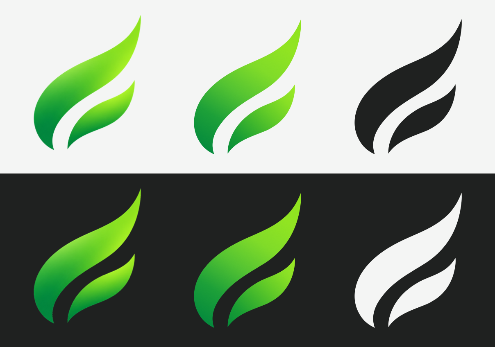

# Pasto's icon

The app icon, the mark on its own, the menu bar glyph, the disk image background and window, and the web exports.
All of them are written by one generator, `Tools/IconKit`, deterministically: no file listed here is edited by hand.
The app icon and the mark have a single source, the logo; the menu bar glyph and the disk image background are
drawn in code.


*At 256, 128, 64, 32 and 16 px at actual size, followed by 32 and 16 px magnified ×6 without smoothing.*

## Concept

*Pasto* is Spanish for grass. The mark is **two leaves of grass**, a large one and a smaller one in its lee, rising
to the right, green from a deep tone at the foot to lime at the tip. There are no letters, cards or arrows. The
**app icon** is the mark on a white tile.

The **menu bar glyph** is the same picture in one colour and in reverse: the app's rounded tile, filled, with a
large leaf and a smaller one cut out of it. The Stack panel's title shows the same glyph.

## The mark

### Source

`Design/icon/source/logo.png`: the mark painted on a **plain white square** (1254 × 1254), with no transparency.
IconKit refuses a logo that is not square, is smaller than 1024 px, has transparent pixels or whose border is not
plain and light. To change the icon, replace that file and run `iconkit all`.

### Lifting the mark off the white

Everything else needs the mark alone, so that it can sit on the tile at any size, on a transparent favicon or on a
dark page (`Mark.swift`). Subtracting the white is not enough: the pixel or two along each edge are a blend of
leaf and background and would keep a pale fringe on anything darker than white. Each of those pixels is split into
the colour of the solid leaf next to it and the share of the pixel the leaf covers, which becomes its alpha.

### The outline

The edge of the mark is also traced into curves (`MarkOutline.swift`): followed between pixels at half coverage,
cut at each leaf's tip and foot, and each stretch fitted with as few cubic curves as stay within 0.9 px of it. The
two leaves come out as about twenty curves. That outline is what the SVG exports are written from; `iconkit all`
fails if the logo does not trace into exactly two shapes with two corners each.



*On a light and a dark strip: the mark as a bitmap, the traced outline filled with each leaf's gradient, and the
outline in one colour.*

## App icon

### Construction

| | |
|---|---|
| Grid | 1024 canvas, **824 tile centred** (100 of margin for the shadow), like every macOS icon |
| Tile corners | continuous (*squircle*), radius **214** on the 824 tile: measured on the system's own icons on macOS 27, whose mask at 1024 px matches this shape to within the anti-aliasing |
| Tile surface | white (`#FFFFFF`) at the top to `#ECF0E9` at the bottom: enough to read as a surface beside a white window |
| Shadow | black at 30 %, 10 down, blur 20 (scaled with the icon) |
| Margin at each size | 100/1024 of the side, rounded down to whole pixels so the tile's edges are crisp: 1 px at 16, 3 px at 32 (as the system's icons), 6 at 64, 12 at 128 |
| Mark | 68 % of the tile's side tall at 128 px and up; larger on the small renditions (below) |

Every rendition is drawn from the mark at its own size, never by scaling another rendition down. The mark is
resampled by halving it until it is within twice the target, so the large reductions do not alias.

**Optical centre.** The leaves are broad at the foot and come to a point at the top, so their weight sits 7.8 % of
the mark's height below the middle of its bounding box; centred by its box, the mark looks as if it had slipped
down. It is moved 40 % of the way towards having its weight in the middle (`AppIcon.opticalShare`), about 3 % of
its height.

### Small sizes

The smaller the icon, the more of the tile the mark takes, so that the two leaves stay apart:

| Rendition | Mark height, share of the tile |
|---|---|
| 16 px | 80 % |
| 32 px | 76 % |
| 64 px | 72 % |
| 128 px and larger | 68 % |

### What goes into the bundle

`Pasto/Assets.xcassets/AppIcon.appiconset` (`ASSETCATALOG_COMPILER_APPICON_NAME` is `AppIcon`): `actool` compiles its
ten PNG files into `Assets.car` and `AppIcon.icns` as they are. It is a classic icon set, not a layered `.icon`
document, so the system shows the icon as drawn, without tinted and clear appearances. Because the tile has the
system's shape, Finder draws it without adding a frame.

About, the welcome window and the permission windows use `NSApp.applicationIconImage`, which reads the icon from the
bundle (`PastoApp/AppIconImage.swift`).

### Exports (`Design/icon/export/`)

| File | What it is |
|---|---|
| `pasto-icon-1024.png`, `pasto-icon-512.png` | the icon with its margin and shadow (the README shows the 512 one) |
| `favicon-32.png` | the tile filling the square, no shadow: browsers show it at 16 pt |
| `favicon-180.png` | `apple-touch-icon`: the tile as an opaque square with a smaller mark (iOS applies its own mask) |
| `favicon-512.png` | the tile filling the square, continuous corners, no shadow |
| `pasto-mark-1024.png` | the mark alone on a transparent square |
| `pasto-mark.svg` | the traced outline, each leaf filled with a gradient of six colours measured along it from foot to tip |
| `pasto-mark-mono.svg` | the traced outline in `currentColor`, for a glyph that takes the text's colour |

## Menu bar glyph (`StatusItemIcon.imageset`)

An **18 × 18 pt** template image (black with alpha; AppKit tints it for the menu bar), at @1x and @2x. It is drawn
once in points and rasterised at each scale; the geometry is chosen so that both scales land on the pixel grid.
Coordinates are in points with y up, from the bottom left of the 18 pt box. Source:
`Tools/IconKit/Sources/iconkit/StatusGlyph.swift`.

| Part | Geometry |
|---|---|
| Tile | 14 × 14 at (2, 2); continuous corners, radius 3.64 (the app icon's 214/824) |
| Large leaf | base centred on (6.5, 4), 4 wide; tip at (12, 14.2); outer edge swell 1, inner 0.5 |
| Small leaf | base centred on (11.75, 4), 2.5 wide; tip at (14, 9.6); outer edge swell 0.35, inner 0.55 |
| Fill | even-odd: the leaves are holes in the tile |

Each leaf has a flat base and a pointed tip: from the left end of its base, a curve to the tip whose control points
are (base.x − width × outer − lean × 0.1, base.y + 0.45 h) and (tip.x − 0.35 width, tip.y − 0.25 h); back to the right
end of the base through (tip.x + 0.1 width, tip.y − 0.45 h) and (base.x + width × inner, base.y + 0.3 h), where h is
the leaf's height and lean how far its tip leans right.

**Pixel rules.**

- The tile's straight edges sit on whole pixels at 1x and 2x, so they stay crisp instead of a grey half pixel.
- The leaves stand on y = 4, a whole pixel at both scales: a 2 pt band of tile below them reads as the ground.
- At 1x, every row and column has at least one fully solid pixel between the two holes, and between each hole and the
  tile's edge: no hairline of half-covered pixels is left anywhere. `iconkit status-item` checks this at both scales
  and refuses to write a glyph that fails it.
- The tile is centred in the box; the leaves sit in its lower right, rising to the upper right like the leaves of the
  app icon.
- **Weight.** 14 pt is the size of the filled squares SF Symbols draw at 15 pt medium (`app.fill`, `square.fill`);
  with the leaves cut out, the glyph covers about 136 pt², between the system's outlined symbols at that size
  (`clock`, `wifi`: 75–90 pt²) and the battery (170–190 pt²).

**States.** `PastoStatusItem` draws the glyph as a template. The capture pulse fades it to 35 % and back; while
capture is blocked the button *appears disabled*, which AppKit draws at about half the opacity; while paused the glyph
gives way to the `pause.circle` symbol. All of them are in the sheet below.


*On a light and a dark menu bar: `wifi`, `battery.75percent`, `magnifyingglass` and `clock` at 15 pt medium with the
glyph, at 1x and at 2x; the glyph at 1x magnified ×8 and at 2x ×4; at 2x, the capture pulse (35 %), capture blocked
(50 %) and the paused symbol; the Stack panel's title.*

**In the Stack panel.** `StackHeader` shows the same image at its own size (18 pt), so both scales draw pixel for
pixel; its 14 pt tile fills the 14 pt room the title gives it, and its margin overflows that room.

## Disk image background and window (`Config/dmg-background.png`, `@2x`)

660 × 400 pt, no text, with a straight arrow (`#3C9D5D`, 5 pt) between the two icon slots. Two versions:

- **On the painted texture** (the one that ships): `Config/dmg-texture.png`, an almost white gradient with a band of
  pale grass along the bottom edge, cropped to 660 × 400 keeping that edge. Only the arrow is drawn on top.
- **Without the texture** (fallback, if `Config/dmg-texture.png` is deleted): a very light sky over a vector
  meadow; both icons stand on the hill, among tufts of blades with a lit fold, with a pale far hill behind and a
  darker slope in front. The labels fall on the meadow's mid tone (`#448257`).

**Labels.** Over a background picture, Finder on macOS 27.2 writes the icon names in black, in the dark appearance
too, and there is no way to set their colour; over the nearly white texture they need nothing behind them.
`dmg-inspect` measures the contrast of black labels on the real disk image and fails below 4:1.

| Element | Value |
|---|---|
| `Pasto.app` / link to `/Applications` (icon centre, pt) | (170, 186) / (490, 186) |
| Icons / labels | 128 pt / 13 pt, below |
| Window | content 660 × 400; frame 660 × 432 (macOS 27's 32 pt title bar); no sidebar, toolbar, status bar or path bar |
| Vector fallback: sky, top / bottom | `#F8FBF7` / `#E4F1E5` |
| Fallback: far hill | `#D3EAD7` → `#C2E1C8` |
| Fallback: meadow, crest / label band / bottom; rim light | `#67A774` / `#448257` / `#427F53`; `#A6D9A6` |
| Fallback: front slope | `#3A7A4E` → `#2A6040` |
| Fallback: meadow blades (tip / root, fold) | `#8CCB86` / `#4F9161`, `#B2E09F` → `#67A774` |
| Arrow | `#3C9D5D`, 5 pt |

Finder does not lay the window out: `scripts/release.sh` mounts the image where Finder does not see it and
`iconkit dmg-window` writes its `.DS_Store` (the `bwsp`, `icvp` with the background alias, `icvl`/`vstl`, `vSrn` and
per-icon `Iloc` records); the volume icon is `.VolumeIcon.icns`, made by `iconkit dmg-stage` from the same renditions
as the app icon set. The file format is documented in `Tools/IconKit/Sources/iconkit/DSStore.swift` and
`FinderAlias.swift`; the steps and checks are in [RELEASING.md](../RELEASING.md).

**Where the texture comes from.** `scripts/import-illustrations.sh` takes `Design/generated/dmg-texture.png`,
crops it to the 660:400 proportion across its full width keeping the bottom edge (its grass), saves it at
1320 × 800 as `Config/dmg-texture.png` and redraws the background with `iconkit dmg`. The icon slots stay clear:
nothing is drawn under them.


And the window as it comes out of a built disk image (records read back from the `.DS_Store`, the volume's real
icons), in light and dark mode:


## Regenerating

```bash
swift run --package-path Tools/IconKit iconkit all     # app icon set, glyph, disk image, exports and previews
scripts/build.sh                                       # checks that the asset catalog compiles
```

Individual commands: `app-icon` (the asset catalog's icon set), `status-item` (the glyph), `dmg` (the disk image
background), `export` (`Design/icon/export/`) and `previews` (the pictures in `docs/design/img/`, except
`dmg-window.png`, which `scripts/release.sh` draws from the built disk image). `previews --before <.appiconset folder>`
also writes a before/after comparison of the icon sizes.

To change the icon, replace the logo; to change how much of the tile the mark takes at each size,
`AppIcon.markHeight` in `Tools/IconKit/Sources/iconkit/AppIcon.swift`. To change the glyph, `StatusGlyph.tile` and
`StatusGlyph.leaves`. After regenerating, look at `docs/design/img/`.

## How it is checked

- Two consecutive runs of `iconkit all` leave the working tree unchanged.
- `iconkit status-item` checks the glyph for hairlines at 1x and 2x before writing it.
- `assetutil --info` on the built `Assets.car` lists the ten `AppIcon` renditions and `StatusItemIcon` at 18 and
  36 px with *Template Mode: template*; loaded from the built bundle, the glyph is an 18 × 18 pt template image with
  both scales.
