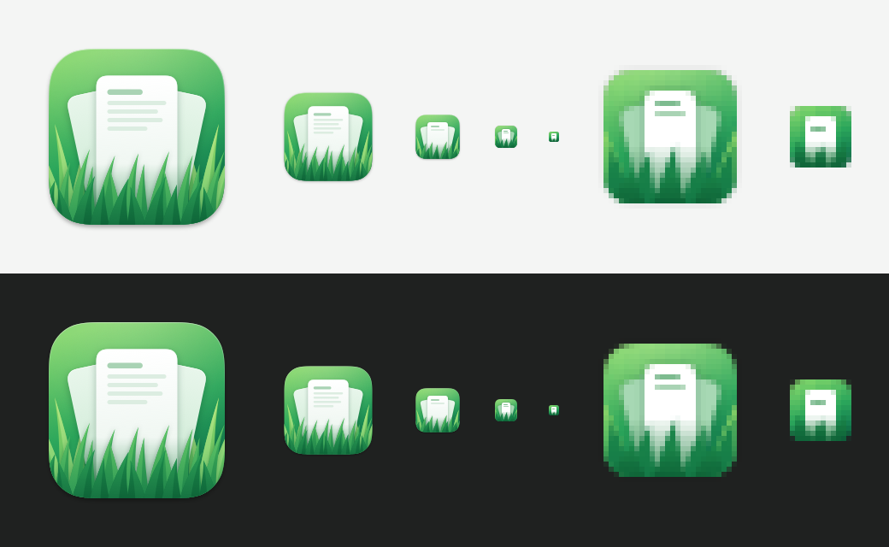
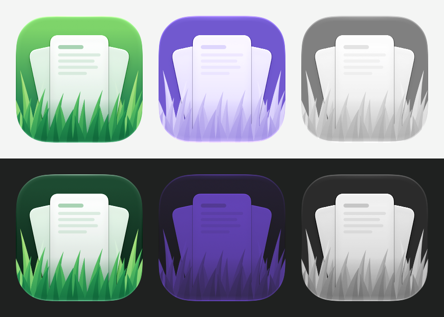
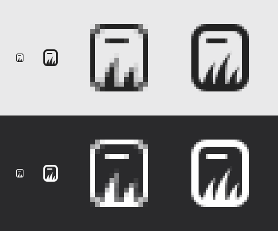
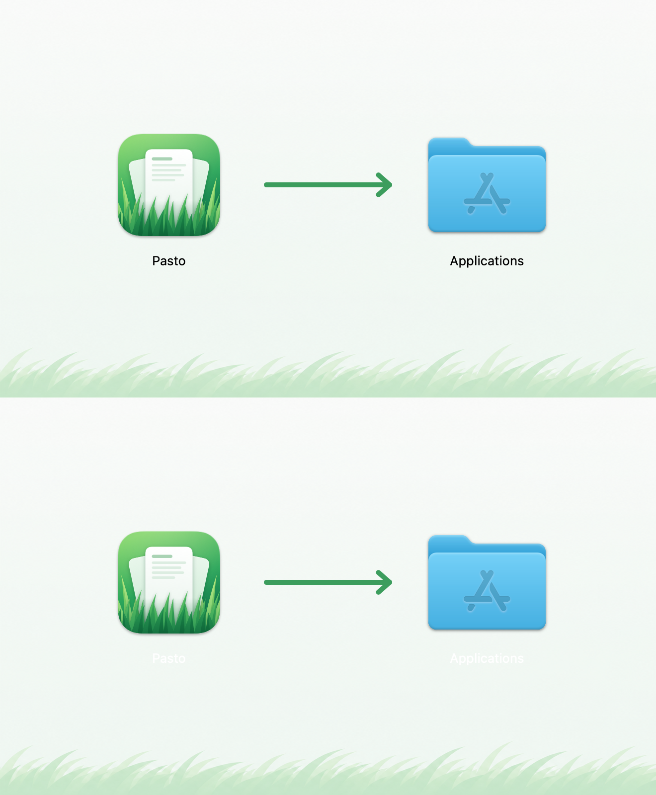
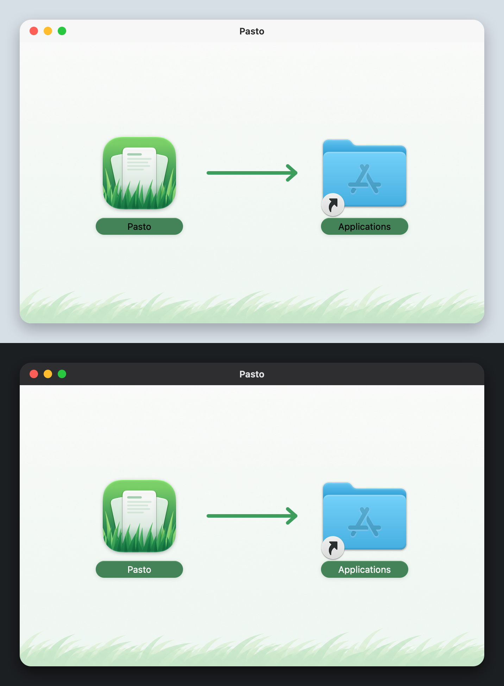

# Pasto's icon

The app icon, the menu bar glyph, the disk image background and the web exports. All of them come from a single
generator, `Tools/IconKit`, deterministically: no file listed here is edited by hand.



*At 256, 128, 64, 32 and 16 px at actual size, followed by 32 and 16 px magnified ×6 without smoothing.*

## Concept

*Pasto* is Spanish for grass. The icon is **three clipboard cards fanned out, growing from a meadow**: the front
card, white with lines of text, is the clip; the two cards behind it, tinted green, stand for the history. Grass
grows in front of and behind the cards, bent slightly to the right by a light breeze, and the cards darken where
they sink into it.

There are no letters or arrows. The green shifts from a sunny, yellowish tone at the top to a bluish emerald at
the bottom, which keeps it apart from the flat greens of the system's own apps.

## Palette

sRGB values. The source of truth is `Palette` in `Tools/IconKit/Sources/iconkit/PastoIcon.swift`.

| Use | Value |
|---|---|
| Tile, top / middle / bottom (slightly diagonal gradient) | `#7DD46A` / `#2BA65B` / `#0A6B4A` |
| Overhead light (radial, top) | `#FFF7D6` at 24 % |
| Tile rim light (fades towards the bottom) | `#FFFFFF` at 50 % |
| Tile shadow (classic format) | `#000000` at 30 %, offset 10, blur 20 |
| Front card, top / middle / in the grass | `#FFFFFF` / `#F0F7F2` / `#7DB590` |
| Back cards, top / middle / in the grass | `#E8F6EB` / `#D6EEDC` / `#5E9F75` |
| Title line / text lines | `#A9D3B4` / `#DCEDE1` |
| Card shadow | `#04381F` at 30 %, offset 12, blur 36 |
| Far grass (behind the cards), tip / root / lit fold | `#9BDB6A` / `#3DAF5C` / `#BCE985`→`#5BC066` |
| Middle grass (in front), tip / root / lit fold | `#45B45B` / `#137645` / `#66CA68`→`#1E8A4E` |
| Near grass (foreground), tip / root / lit fold | `#1C8A4B` / `#08532F` / `#2A9C54`→`#0D6139` |
| Small sizes: title line / back cards | `#7DBB8F` / `#A7D8B4` |
| Dark appearance (Icon Composer), tile top / bottom | `#1D4A31` / `#0A2116` |
| Menu bar glyph | black with alpha (template image; AppKit tints it) |
| Disk image | see "Disk image background and window" below |

## Construction

### Grid

A 1024 canvas on the macOS icon grid: an **824 tile, centred** (100 of margin for the shadow), continuous corners
(*squircle*) with a radius of 185.4, and the shadow inside the canvas. Coordinates have their origin at the top
left.

### Layers, back to front

1. **Tile**: a three-stop gradient, a radial overhead light and a 3-unit rim light that fades out at 42 % of the
   height.
2. **Far grass**: two tall tufts of three blades at the sides, leaning outwards; they frame the fan.
3. **Back cards**: 380 × 650, radius 48, rotated ±12° around (512, 980); they start 48 lower than the front card
   so that their inner corner does not show. Each has a thread of light along its top edge.
4. **Front card**: 380 wide, top at y = 226, radius 48, soft shadow. Five rounded lines of text: a title (26 high,
   60 % of the width) and four lines 20 high at 100/86/94/68 % of the width.
5. **Middle grass**: 14 blades in front of the cards, bent by the breeze to the right (they overlap like scales
   instead of crossing); their tips stop between y ≈ 570 and 660, below the text. It casts a soft shadow on the
   cards.
6. **Near grass**: 11 wider, darker blades that ground the composition; their roots sit below the tile, so no
   strip of soil is needed.

Each **blade** (`Blade`: base, width, height, lean, stiffness) is a tapering ribbon around a curved spine: it
leaves the ground vertically and bends towards the tip, and the outer edge of the curve keeps more width. The half
facing the light (the outside of the curve) is painted lighter, like a fold. Each row has a vertical gradient from
the root (dark) to the tip.

### Small sizes

Every size is drawn from vectors, never by scaling a bitmap down, with its own level of detail:

| Pixels | Art | Simplification |
|---|---|---|
| ≥ 128 | `full` | everything above |
| 64 | `medium` | two 2 px lines of text, 7 + 5 blades with the same breeze, no thread of light |
| 32 | `small` | a 26 px tile (like the system's), a 10 px front card on whole pixels and clearly the lightest, back cards as tinted strips, two 1 px lines, flat and darker blades |
| 16 | `tiny` | a 12 px tile (like the system's), a single 6 px white card with one line and three dark blades |

### Icon Composer (`Pasto/AppIcon.icon`)

A folder document with `icon.json` and its layers in `Assets/` (SVG; the canvas is the tile's square, 1024 with no
margin, and the system applies its shape, its shadow and Liquid Glass).

- **Background**: the document's `fill`, a `#7DD46A` → `#0A6B4A` gradient; in dark mode, `#1D4A31` → `#0A2116`
  (`fill-specializations` with `appearance: dark`). The system derives the **tinted** and **clear** variants, which
  is why the background is a fill and not a layer.
- **Groups** (top to bottom): near + middle grass (neutral shadow 0.35); text + front card + back cards (shadow 0.5,
  specular highlight; **both card layers are glass**, which gives them the lit edge the classic format draws by
  hand); far grass.
- Text and grass are not glass: glass lines look like embossed tiles, and the grass loses its colour.



*Rendered with `ictool`, Icon Composer's renderer, from the document in the repository.*

### Menu bar glyph (`StatusItemIcon.imageset`)

The motif, reduced: the outline of a card with one line of text and a tuft of grass growing inside it, leaning like
the icon's. **18 × 18 pt** (the logical size `PastoStatusItem` uses), as a template image. Each scale is drawn on
its own pixel grid: the outline is a filled ring with every edge on whole pixels (1.5 pt at @2x, like the menu
bar's SF Symbols; 1 px at @1x), and @1x has two blades instead of three so that there is a gap between them.



### Disk image background and window (`Config/dmg-background.png`, `@2x`)

660 × 400 pt, no text, with a straight arrow (`#3C9D5D`, 5 pt) between the two icon slots. Two versions:

- **On the painted texture** (the one that ships): `Config/dmg-texture.png`, an almost white gradient with a band of
  pale grass along the bottom edge, cropped to 660 × 400 keeping that edge. Only the arrow and a capsule plate under
  each label (124 × 24 pt, `#448257` with a lit rim) are drawn on top.
- **Without the texture** (fallback, if `Config/dmg-texture.png` is deleted): a very light sky over a vector
  meadow; both icons stand on the hill, the way the icon's cards grow from the grass, among tufts of blades (the
  icon's blade, with its lit fold), with a pale far hill behind and a darker slope in front.

**Labels that read in light and dark mode.** Finder writes each icon's name in black in the light appearance and
in white in the dark one, and does not adapt the background (there is no way to set the label colour). So every
label sits on a mid tone (`#448257`, luminance 0.179: the plate on the texture, the meadow in the vector version)
that gives both colours the same contrast, 4.6:1, the highest possible for both at once. `dmg-inspect` measures it
on the real disk image and fails below 4:1.

| Element | Value |
|---|---|
| `Pasto.app` / link to `/Applications` (icon centre, pt) | (170, 186) / (490, 186) |
| Icons / labels | 128 pt / 13 pt, below |
| Window | content 660 × 400; frame 660 × 432 (macOS 27's 32 pt title bar); no sidebar, toolbar, status bar or path bar |
| Label plate (on the texture) | 124 × 24 pt, centred 12 pt below the icon plus 64; `#448257`, rim `#6FAF7C` at 55 % |
| Vector fallback: sky, top / bottom | `#F8FBF7` / `#E4F1E5` |
| Fallback: far hill | `#D3EAD7` → `#C2E1C8` |
| Fallback: meadow, crest / label band / bottom; rim light | `#67A774` / `#448257` / `#427F53`; `#A6D9A6` |
| Fallback: front slope | `#3A7A4E` → `#2A6040` |
| Fallback: meadow blades (tip / root, fold) | `#8CCB86` / `#4F9161`, `#B2E09F` → `#67A774` |
| Arrow | `#3C9D5D`, 5 pt |

Finder does not lay the window out: `scripts/release.sh` mounts the image where Finder does not see it and
`iconkit dmg-window` writes its `.DS_Store` (the `bwsp`, `icvp` with the background alias, `icvl`/`vstl`, `vSrn` and
per-icon `Iloc` records); the volume icon is `.VolumeIcon.icns`, this same icon at every size. The file format is
documented in `Tools/IconKit/Sources/iconkit/DSStore.swift` and `FinderAlias.swift`; the steps and checks are in
[RELEASING.md](../RELEASING.md).

**Where the texture comes from.** `scripts/import-illustrations.sh` takes `Design/generated/dmg-texture.png`,
crops it to the 660:400 proportion across its full width keeping the bottom edge (its grass), saves it at
1320 × 800 as `Config/dmg-texture.png` and redraws the background with `iconkit dmg`. The icon slots stay clear:
nothing is drawn under them.



And the window as it comes out of the built disk image (records read back from the `.DS_Store`, the volume's real
icons), in light and dark mode:



### Exports (`Design/icon/export/`)

| File | What it is |
|---|---|
| `pasto-icon-1024.png`, `pasto-icon-512.png` | the classic icon (with margin and shadow) |
| `pasto-icon.svg` | the same icon as SVG (the shadow is an `feDropShadow`) |
| `favicon-32.png` | full-bleed tile with the 32 px art |
| `favicon-180.png` | `apple-touch-icon`: an opaque square (iOS applies its own mask) |
| `favicon-512.png`, `favicon.svg` | full-bleed tile with continuous corners, no shadow |

## What goes into the bundle

`actool` receives `Pasto/AppIcon.icon` (the `Pasto/` folder is synchronised with the target, so the project file
did not need to change) and `Assets.xcassets`. **When both exist under the name `AppIcon`, the `.icon` wins**:
`Assets.car` carries the icon stack (`AppIcon.iconstack`, with light, dark and tintable appearances and vector
layers) and `AppIcon.icns` is generated by rendering that document. The PNG files of the `.appiconset` do not go
into the bundle.

As a consequence, the system rasterises the small sizes from the layers; at 16 px they look softer than the
hand-tuned `tiny`/`small` variants. That trade-off is deliberate: the deployment target is macOS 27, and the `.icon`
gives Liquid Glass, dark mode and tinting, and avoids the grey frame macOS can put around classic icons. To prefer
the hand-tuned small sizes, delete `Pasto/AppIcon.icon`: the build falls back to the `.appiconset` with no other
change.

About, the welcome window and the permission windows use `NSApp.applicationIconImage`, which reads the icon from the
bundle, so they do not depend on the format.

## Regenerating

```bash
swift run --package-path Tools/IconKit iconkit all     # asset catalog, .icon, glyph, disk image, exports and previews
scripts/build.sh                                       # checks that actool compiles both formats
```

Individual commands: `app-icon`, `icon-composer`, `status-item`, `dmg`, `export`, `previews`; `draft <folder>` makes
quick renders outside the repository for iterating. The Icon Composer appearances need `ictool` (inside
`Xcode.app/Contents/Applications/Icon Composer.app`); without it, `previews` skips them.

To change the design: colours in `Palette`, geometry in `IconArt.full` (and its small variants), groups and glass of
the `.icon` in `IconComposer.groups`. After regenerating, look at `docs/design/img/` and update the palette in this
document if it changed.

## How it is checked

- The `.icon` format follows Xcode 27's template and documents written by Icon Composer; the specialisations
  (`fill-specializations` with `appearance`) and the layer order are checked by rendering all six appearances with
  `ictool`.
- `assetutil --info` on the built `Assets.car` lists `AppIcon.iconstack` in its three appearances and the glyph at
  @1x and @2x.
- The SVG files validate with `xmllint`, and AppKit rasterises them like the PNG files.
- Two consecutive runs of the generator produce byte-identical files.
