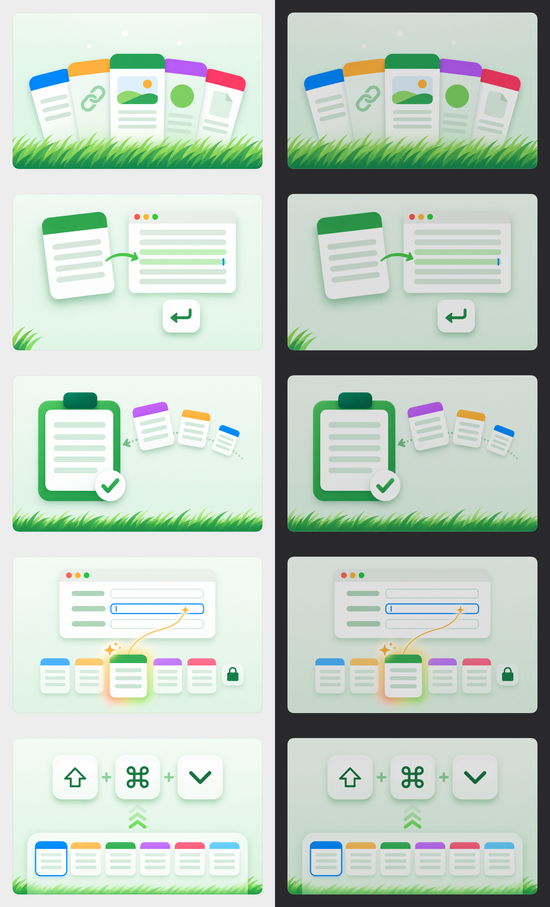
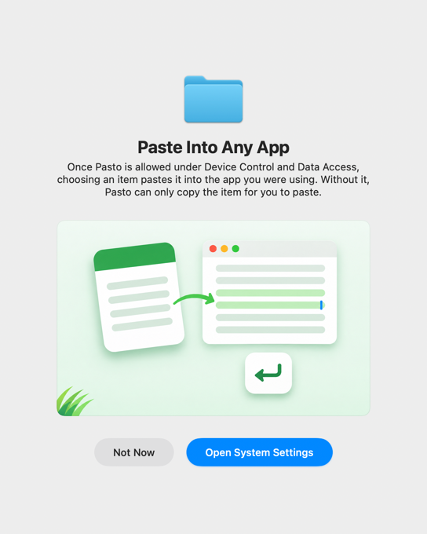
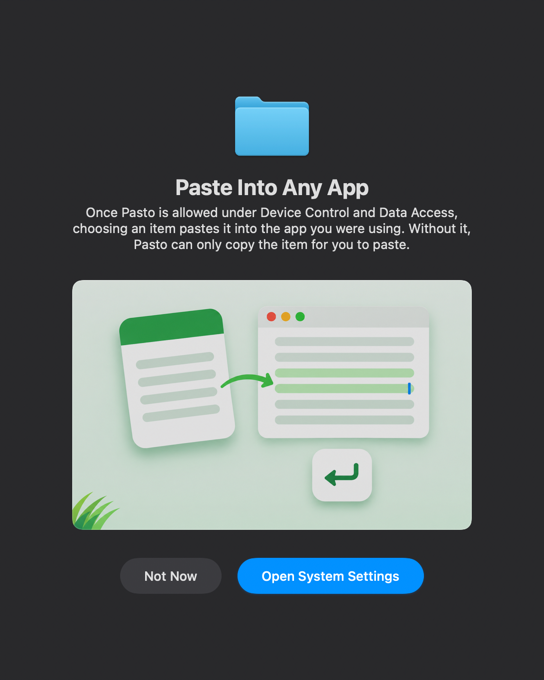
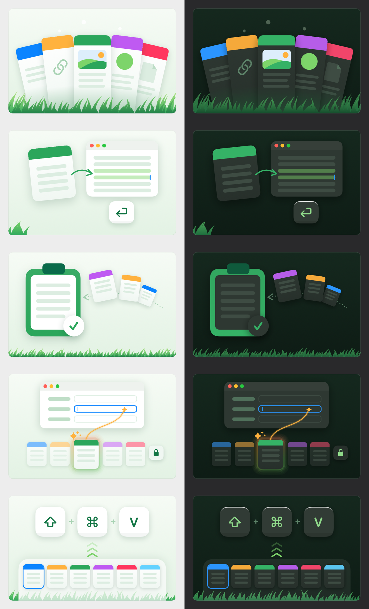

# Welcome and permission artwork

The illustrations of the welcome window (intro, Quick Start and the permission steps it includes) and of the
permission windows (Accessibility, clipboard access, screen recording and the "paste into other apps" prompt).

Every illustration has two forms: a painted picture, which is the artwork that ships, and a vector fallback drawn
in code with the same composition.



## The scenes

| Illustration | Scene (the same in the picture and the vector) | Shown in |
|---|---|---|
| `intro` | a fan of five cards (text, link, image, colour, file) growing from the grass, with flecks of pollen | welcome, first step |
| `accessibility` | a card travels along an arrow to a window, where its text lands (two highlighted lines and the caret); the Return key | welcome, Accessibility window, "paste into other apps" prompt |
| `pasteboard` | cards arriving along a dotted arc at a clipboard with a check mark; grass below | welcome, clipboard access window |
| `suggestions` | a window with a form and its focused field; below, a row of cards with the suggested one raised inside a warm halo and a line of light up to the field; a padlock: everything stays on the Mac | welcome, screen recording window |
| `quickStart` | ⇧ ⌘ V over the panel rising from the bottom edge, with its row of cards and the first one selected | welcome, last step |

**Sizes.** Every illustration is shown at **8:5**, the proportion of the pictures' safe area (1280 × 800 inside
their 1536 × 1024 canvas). The permission windows (544 × 680 pt) show it at **400 × 250 pt**, with a corner radius
of 10 and 28 pt above and below; the "paste into other apps" prompt shows it full-bleed at the top, at
**280 × 175 pt**.




**Static.** Nothing animates or redraws, so the illustrations cost nothing while the welcome moves between steps.

## Painted pictures and vector fallback

1. **Painted pictures (the artwork that ships).** The source PNG files live in `Design/generated/`.
   `scripts/import-illustrations.sh` checks each one (3:2 canvas, at least 1536 px wide, no transparency), crops it
   to 8:5 and writes @1x, @2x and @3x (400 × 250, 800 × 500 and 1200 × 750 px) into `Resources/Illustrations/` of
   the module that shows it: intro and Quick Start in `PastoOnboarding`; Accessibility, clipboard and suggestions
   in `PastoPermissions`.

   | Picture | Crop (1536 × 1024 → 1536 × 960) | Why |
   |---|---|---|
   | intro, accessibility, pasteboard, quickstart | full width, **keeping the bottom edge** | the grass (or the Quick Start panel) runs off the bottom edge and must not be cut |
   | suggestions | full width, centred | it touches no edge |

   The crop always contains the whole safe area. The pictures exist only in a light version: in **dark mode** they
   are shown inside their rounded frame (radius 10) under a 12 % black veil, with a hairline of the label colour at
   16 % (7 % in light mode), so the light card sits framed in the dark window without glare.

2. **Vector fallback.** When the picture of an illustration is missing, it is drawn in code with the same
   composition, in a SwiftUI `Canvas`: sharp at any scale, with its own light and dark palettes (the dark one is a
   night meadow with slate paper) and no blurs (halos are stacked rings; shadows are the shapes' own). It draws in
   milliseconds.



### Palette

| Use | Light | Dark (vector only) |
|---|---|---|
| Background, top / bottom | `#F6FBF5` / `#E3F2E4` | `#15281E` / `#0E1C15` |
| Paper, top / bottom | `#FFFFFF` / `#F0F7F2` | `#2E3832` / `#27302B` |
| Text bars / ink | `#DCEDE1` / `#A9D3B4` | `#3E4C43` / `#5C8268` |
| Greens: light, medium, deep | `#7DD46A`, `#2BA65B`, `#0A6B4A` | `#7DD46A`, `#35B266`, `#0F5A3C` |
| Warm accent / selection blue | `#FFB23E` / `#0A84FF` | `#FFB23E` / `#2B95FF` |
| Card bands: blue, amber, green, purple, pink, cyan | `#0A84FF`, `#FFB23E`, `#2BA65B`, `#BF5AF2`, `#FF375F`, `#64D2FF` | slightly softer |
| Shadow | `#04381F` at 18 % | black at 42 % |

Source of truth: `IllustrationPalette` in `Packages/PastoKit/Sources/PastoPermissions/Illustrations/IllustrationArt.swift`;
numbers in `IllustrationMetrics.swift` and, for the windows, `PermissionMetrics`.

## Using them

```swift
OnboardingIllustration(.intro)                          // PastoOnboarding: .intro, .accessibility, .pasteboard, .suggestions, .quickStart
PermissionIllustration(.pasteboard)                     // PastoPermissions: .accessibility, .pasteboard, .suggestions
PermissionIllustration(.accessibility, cornerRadius: 0) // full-bleed, as in the "paste into other apps" prompt
```

On their own they measure 400 × 250 pt (`defaultSize`); given a width, they keep 8:5. They crop, round, frame and
dim themselves. The three permission illustrations of `OnboardingIllustration` are the same ones the permission
windows show.

## Regenerating

```bash
scripts/import-illustrations.sh            # Design/generated → @1x–@3x resources, Config/dmg-texture.png and the disk image background
PASTO_ILLUSTRATION_RENDERS=/tmp/renders swift test --package-path Packages/PastoKit \
    --filter "IllustrationRenders|PermissionWindowRenders"   # a PNG of every illustration and window, light and dark
```

The renders are a renderer inside the test targets that does nothing without the environment variable (there are
no UI test suites). It fixes the appearance and can force the vector art (`illustrationArtwork = .vector`) for
comparison. The images on this page are those renders, scaled down.

To change an illustration: replace its picture in `Design/generated/` (same name, same canvas rules) and import
again; or, for the fallback, edit its scene in `PermissionScenes.swift` / `OnboardingScenes.swift`. A picture that
is missing is skipped by the import, and the app keeps drawing the vector art for it.
